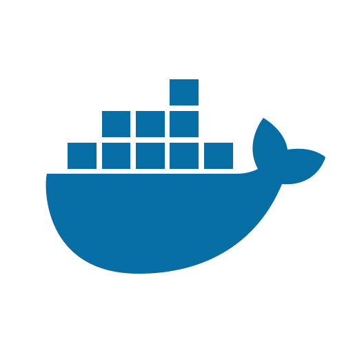

# Marcos Juliano

**Estudante de Sistemas de Informação | Desenvolvimento de Software**

Manaus, Amazonas — Brasil

[LinkedIn](https://www.linkedin.com/in/marcosjulian0/) · [GitHub](https://github.com/MarcosJuliano) · [E-mail](mailto:marcosjuliano081@gmail.com)

---

### Sobre mim

Sou estudante do 4º período de **Sistemas de Informação** no Centro Universitário CEUNI – FAMETRO, com previsão de conclusão em dezembro de 2028.

Tenho interesse em desenvolvimento de software, especialmente em aplicações web, integração entre front-end e back-end, bancos de dados e automação.

Desenvolvo projetos acadêmicos e pessoais para aprimorar meus conhecimentos em programação, estruturas de dados, arquitetura de aplicações e ferramentas de desenvolvimento.

Atualmente, busco oportunidades de estágio e início de carreira em tecnologia, com interesse em desenvolvimento de software e testes.

---

### Tecnologias e ferramentas

**Linguagens de programação**

  
  
  

**Desenvolvimento Web**

  
  
  <!--  -->

**Banco de dados**

  

**Ferramentas e ambiente de desenvolvimento**

  
  
  
  
  <!-- -->

**Conhecimentos em desenvolvimento**

`Algoritmos` · `Estruturas de Dados` · `POO` · `SQL` · `DOM` · `APIs` · `Git` · `Containerização` · `Design Responsivo`

---

### Atividade e contribuições

<!-- Pac-Man -->
<picture>
  <source media="(prefers-color-scheme: dark)" srcset="https://raw.githubusercontent.com/MarcosJuliano/MarcosJuliano/output/pacman-contribution-graph-dark.svg">
  <source media="(prefers-color-scheme: light)" srcset="https://raw.githubusercontent.com/MarcosJuliano/MarcosJuliano/output/pacman-contribution-graph.svg">
  
</picture>

### Estatísticas do GitHub

| Estatísticas do GitHub | Linguagens por Repositório | Linguagens por Commits |
| :---: | :---: | :---: |
|  |  |  |

| Estatísticas do perfil | Sequência de contribuições |
| :---: | :---: |
|  |  |

---

**Aberto a oportunidades de trabalhos e desenvolvimento profissional em Tecnologia da Informação.**

[Entre em contato](mailto:marcosjuliano081@gmail.com)

